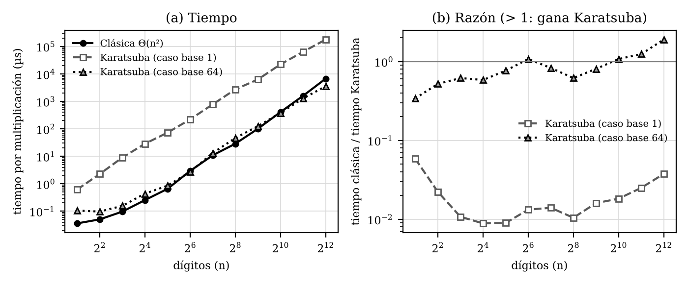

# Práctica 2 — Multiplicación de Karatsuba (C++17)

**Curso:** 0360_2666 — Estructura de Datos y Algoritmos 2
**Integrantes:** Machado Sanchez, Cristobal — Rodriguez Gonzalez, Maria Camila — Sanchez Gomez, Sebastian

Implementación de la multiplicación clásica Θ(n²) y de Karatsuba Θ(n^log₂3) sobre enteros de tamaño arbitrario,
con validación y medición experimental. El análisis teórico está en `Informe_Practica2_Karatsuba.pdf` (fuente `.docx`).

## Estructura
| Archivo | Contenido |
|---|---|
| `bignum.hpp` | `Num` (cadena de dígitos base 10, más significativo primero) y auxiliares: `sumar`, `restar`, `desplazar`, `partir`, `normalizar`, `rellenar` |
| `multiplicacion.hpp` | `multiplicacionClasica` y `karatsuba` (recursivo, tres productos) |
| `pruebas.cpp` | Validación: Karatsuba vs. clásica y vs. referencias independientes, casos de borde |
| `benchmark.cpp` | Tiempos para 2..4096 dígitos (`steady_clock`, mínimo de 5 tandas), salida CSV y punto de cruce |
| `graficar.py` | Genera `tiempos.png` a partir de los CSV (requiere `matplotlib`) |
| `tiempos_base*.csv`, `tiempos.png` | Datos y gráfica de la experimentación (base = caso base de Karatsuba, en dígitos: 1, 32, 64 y 128) |
| `Informe_Practica2_Karatsuba.*` | Informe (deducción, recurrencia, análisis experimental, conclusiones, declaración de IA) |

## Compilar y ejecutar
```
g++ -O2 -std=c++17 -Wall -Wextra pruebas.cpp -o pruebas && ./pruebas
g++ -O2 -std=c++17 -Wall -Wextra benchmark.cpp -o benchmark && ./benchmark > tiempos_base1.csv
g++ -O2 -std=c++17 -DUMBRAL_BASE=64 benchmark.cpp -o benchmark64 && ./benchmark64 > tiempos_base64.csv
python3 graficar.py
```
`UMBRAL_BASE` es el caso base de Karatsuba: 1 por defecto (Karatsuba puro); con `-DUMBRAL_BASE=64` los productos de
64 dígitos o menos se hacen con la multiplicación directa. `./pruebas` debe terminar con todas las pruebas correctas
(se puede repetir con distintos `-DUMBRAL_BASE`). Los CSV de base 32 y 128 se generan igual cambiando `-DUMBRAL_BASE`. Cada ejecución del benchmark tarda menos de un minuto.

## Resultados (resumen)


| n | Clásica (µs) | Karatsuba base 1 (µs) | Karatsuba base 64 (µs) |
|---:|---:|---:|---:|
| 64 | 2,93 | 221,2 | 2,72 |
| 512 | 100,9 | 6 296 | 125,0 |
| 1024 | 408,8 | 22 415 | 380,7 |
| 4096 | 6 739 | 179 171 | 3 549 |

- Karatsuba puro (base 1) no supera a la clásica en 2..4096 dígitos: la constante oculta (asignaciones y copias de cadenas) pesa más que el ahorro de productos.
- Con base 64 el cruce aparece entre 512 y 1024 dígitos y a 4096 Karatsuba es 1,9 veces más rápido (con base 128: 2,5 veces; con base 32 el cruce se retrasa a 2048–4096).
- Pendiente log-log entre 512 y 4096: 2,02 (clásica) y 1,61 (Karatsuba puro), frente a la teoría: 2 y log₂3 ≈ 1,585.

Medido en Linux virtualizado (Intel Xeon 2,10 GHz, 2 vCPU), g++ 13.3 `-O2`; los tiempos absolutos y el punto de cruce cambian según el equipo.
